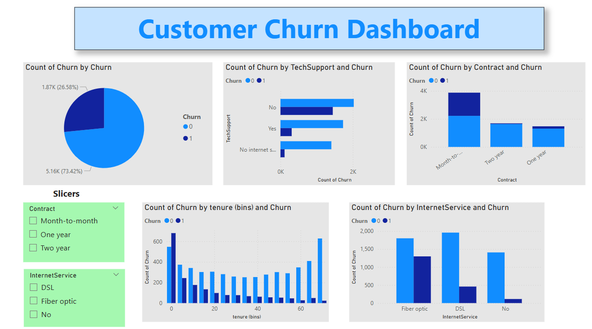

# 📊 Customer Churn Prediction

---
## 📌 Overview

This project predicts whether a customer will **churn** (stop using a service) based on historical customer data.  
It uses **machine learning models** to identify high-risk customers so that retention strategies can be implemented.

---
## ✨ Features

- Data preprocessing & feature engineering.
- Model training using algorithms like Logistic Regression, Random Forest, or XGBoost.
- Evaluation metrics: Accuracy, Precision, Recall, F1-score.
- Visualizations for churn distribution and feature importance.
   
---

🚀 Usage

Run the Jupyter notebook:
  customer_churn.ipynb

---
📊 Example Results

Accuracy: 0.87

---
📊 Top 3 Important Features:

- Contract type.
- Tenure.
- Monthly charges.
  
---

## 📊 Dashboard

